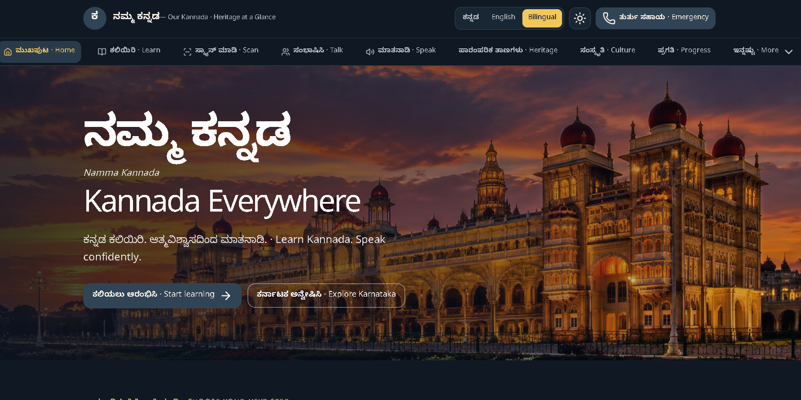
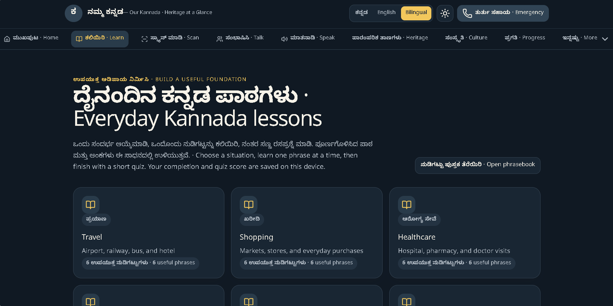
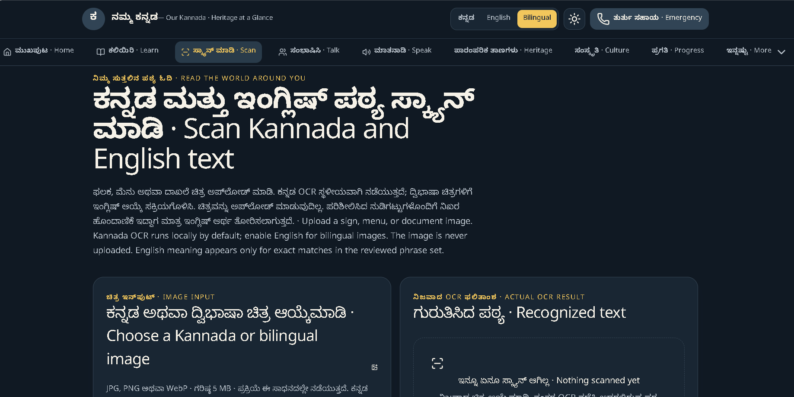
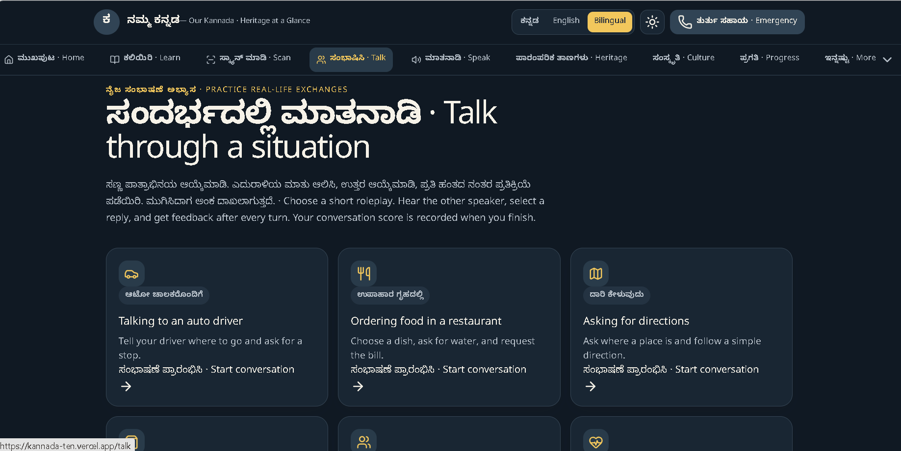
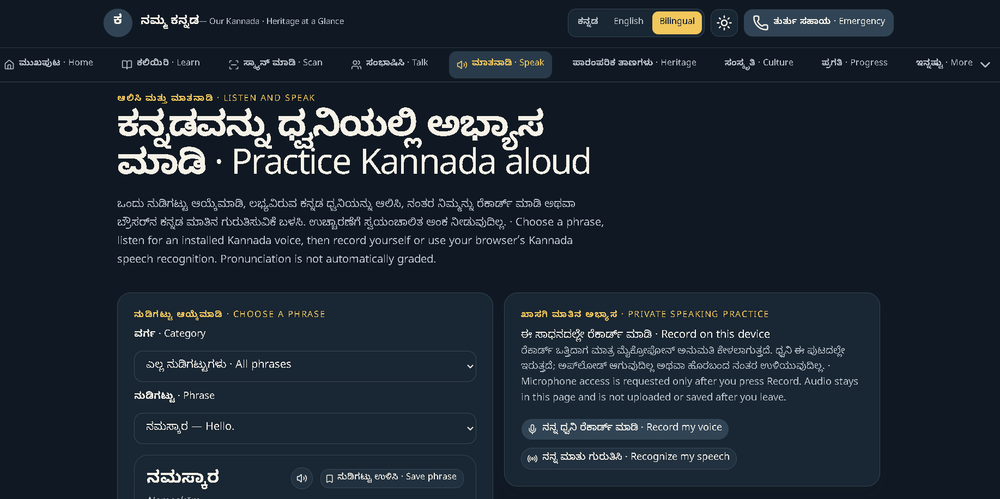
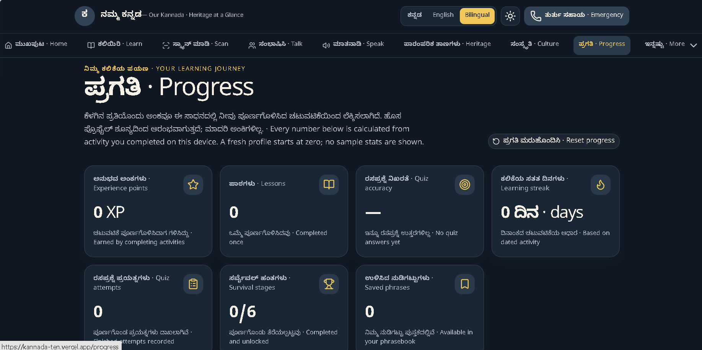

# ಕನ್ನಡ Everywhere | Kannada Everywhere

Learn Kannada. Understand Kannada. Speak Confidently.

Kannada Everywhere is an interactive, bilingual Kannada-learning platform designed to help people learn and use Kannada in everyday situations. It brings together practical language lessons, real-life conversation practice, voice interaction, and Kannada text recognition in one accessible web application.

🔗 Live Website: https://kannada-ten.vercel.app/

---

## 📌 Problem Statement

Problem Statement 01 – Kannada for Everyone

Many people who move to Karnataka, visit the state, or interact with Kannada-speaking communities face language barriers in everyday situations.

Traditional learning methods may not provide enough opportunities to practise practical conversations, understand Kannada signboards, or develop speaking confidence.

Kannada Everywhere aims to make learning Kannada more accessible, practical, and interactive.

## 💡 Our Solution

Kannada Everywhere provides a single platform where users can learn Kannada step by step and practise using it in real-world situations.

Instead of focusing only on vocabulary and grammar, the platform combines learning, listening, speaking, reading, and cultural awareness to support practical language use.

## ✨ Key Features

1. Interactive Kannada Learning

- Learn useful Kannada phrases through everyday categories.
- Explore travel, shopping, healthcare, transport, and other situations.
- View Kannada script, pronunciation, and English meanings.
- Practise with audio and interactive quizzes.

2. Kannada Text Scanner (OCR)

- Upload Kannada or bilingual images.
- Recognise Kannada and English text using OCR.
- View the extracted text.
- Understand supported phrases through English meanings.
- Process images locally in the browser.

3. Real-Life Conversation Practice

- Practise everyday situations through interactive role-play.
- Choose responses in conversations such as talking to an auto driver, ordering food, and asking for directions.
- Receive feedback and learn from incorrect responses.

4. Kannada Speaking Practice

- Listen to Kannada phrases.
- Record your own voice.
- Use browser-based speech recognition to practise spoken Kannada.

5. Karnataka Heritage and Culture

- Explore important heritage destinations in Karnataka.
- Discover cultural information and traditions.
- Learn useful greetings and expressions.

6. Phrasebook and Quiz

- Access useful Kannada phrases.
- Save phrases for future reference.
- Test your knowledge through interactive quizzes.

7. Progress Tracking

- Track completed lessons and quiz attempts.
- Earn experience points (XP).
- Monitor learning streaks and achievements.
- View your learning activity.

8. Emergency Kannada

- Access important emergency information and useful Kannada expressions for urgent situations.

---

## 🛠️ Technology Stack

| Technology | Purpose |
|---|---|
| Next.js | Web application framework |
| React | User interface development |
| TypeScript | Type-safe development |
| Tailwind CSS | Styling and responsive design |
| Tesseract.js | Optical Character Recognition (OCR) |
| Browser Speech APIs | Voice recording and speech recognition |
| Vercel | Application deployment |
| GitHub | Source code management |

## 📸 Application Screenshots

### Home Page

### Learn Page

### Scan Page

### Talk Page

### Speak Page

### Progress Page

## 🚀 Getting Started

Follow these steps to run the project locally.

Prerequisites

- Node.js
- pnpm package manager
- Git

Installation

1. Clone the repository

git clone https://github.com/shrirakshashenoy197/kannada-for-everyone.git

2. Navigate to the project directory

cd kannada-for-everyone

3. Install dependencies

pnpm install

4. Start the development server

pnpm dev

5. Open the application

Visit:

http://localhost:3000

---

## 🔐 Privacy and Accessibility

- The platform provides Kannada and English language support.
- OCR processing is designed to run locally in the browser.
- Voice recording is performed on the user's device.
- Learning progress is stored locally on the device.

Browser support and speech recognition availability may vary.

---

## 🎯 Project Impact

Kannada Everywhere aims to:

- Reduce everyday language barriers.
- Help newcomers communicate with Kannada-speaking communities.
- Encourage practical Kannada learning through interactive activities.
- Improve confidence in reading and speaking Kannada.
- Promote awareness of Karnataka's language, heritage, and culture.

## 🔮 Future Enhancements

- More advanced Kannada speech and pronunciation evaluation.
- Expanded OCR support for different image qualities and text styles.
- Additional real-life conversation scenarios.
- More Kannada dialect and regional language resources.
- Improved offline learning support.

---

---

## 📋 Project Information

| Detail | Information |
|---|---|
| Project Name | Kannada Everywhere |
| Problem Statement | PS 01 – Kannada for Everyone |
| Developer | Shriraksha Shenoy |
| Institution | Canara Engineering College |
| Location | Mangaluru, Karnataka |

---

### ಕನ್ನಡ ಕಲಿಯೋಣ, ಕನ್ನಡ ಮಾತನಾಡೋಣ, ಕರ್ನಾಟಕವನ್ನು ಅರಿಯೋಣ!

**Kannada Everywhere – Making Kannada learning practical, accessible, and interactive.**
